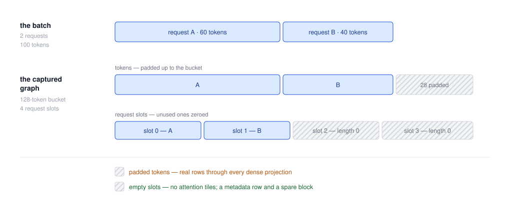
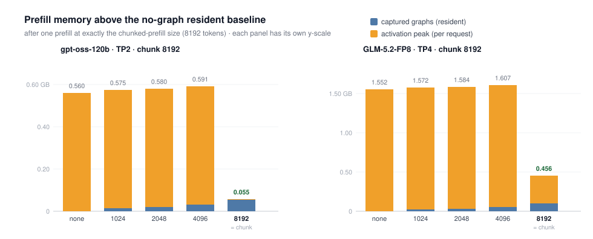

> BCG 通过交替执行 CUDA Graph 段与 eager 函数，在保留动态逻辑的同时减少 CPU kernel launch 开销。
> 本文翻译并分析 SGLang 的 [Advanced CUDA Graph Techniques in SGLang](https://www.lmsys.org/blog/2026-08-17-advanced-cuda-graph/)，介绍其执行机制、分桶策略与显存管理。

## 执行机制

开发者用 `@eager_on_graph` 标记需要正常执行的函数。Capture 遇到该函数时，结束当前 graph 段，执行函数，再开启新段。Replay 按相同顺序执行各 graph 段和 eager 函数，后者内部的 Python 逻辑每轮都会运行，也可以调用 GPU kernel。

例如，模型可以划分为：`Graph A → eager attention → Graph B`。BCG 不会自动发现所有不兼容操作，切分位置需要显式标记。

## Boundary tensor

CUDA Graph 在 capture 时记录 kernel 使用的输入、输出 tensor 的 GPU 地址，普通 replay 会继续读写这些地址，但其中的数据可以更新。地址也可以通过 CUDA Graph Update API 在约束范围内修改，不过需要额外的 API 调用和参数维护；[CUDA Graph 参数更新说明](https://docs.nvidia.com/cuda/archive/13.4.2/cuda-programming-guide/04-special-topics/cuda-graphs.html#updating-instantiated-graphs)。

以 `Graph A → eager 函数 → Graph B` 为例，两种衔接方式不同：

- **Graph A → eager**：capture 时已保留 Graph A 输出 tensor 的访问方式。每次 replay，Graph A 把本轮结果写入相同的输出存储，BCG 随后将对应 tensor 作为参数调用 eager 函数。Eager kernel 可以正常接收这个地址，通常不需要额外复制；
- **eager → Graph B**：eager 函数正常执行，结果可以是地址不固定的 tensor。BCG 将其中的数据复制到 Graph B 预先保留、地址固定的输入 resident tensor（即此处的 Boundary tensor）中，再 replay Graph B。Graph B 始终从这个 resident tensor 的地址读取本轮数据，不需要重新传入 eager 输出的地址。

下面是 graph 已 capture 后的执行示意，`graph_a_output` 是 Graph A 的输出 tensor，`boundary_tensor` 是 Graph B 的输入 resident tensor，两者均已预先保留：

```python
graph_a.replay()                         # 更新固定地址上的 graph_a_output
new_output = eager_fn(graph_a_output)    # 直接读取 Graph A 的输出
boundary_tensor.copy_(new_output)        # 更新内容，保持 Boundary tensor 地址不变
graph_b.replay()                         # 从已绑定的 Boundary tensor 地址读取
```

上述操作需保证 GPU 执行顺序，例如在同一 CUDA stream 上依次提交。这里的 persistent 指 Boundary tensor 的存储跨 replay 保留、内容反复覆盖，不是每轮新增一份；相关 graph 不再使用后才可回收。新输出仍须与后续 graph 的形状等要求兼容。如果 eager 函数支持直接写入指定的输出 buffer，也可以通过这种接口避免额外复制。

## 与 TC(Torch Compile) Piecewise 的区别

两者都能形成 graph 段与 eager 区域交替的结构，但构建方式不同：

| 方案 | 构建流程 |
| --- | --- |
| BCG | 执行 capture 时，按函数标记直接切段。 |
| TC Piecewise | `torch.compile(fullgraph=True)` 先追踪为 FX 图，再按注册切分点分段、编译和 capture。 |

TC 路径要求算子及边界接口能被编译器表示，自定义 kernel 可能需要 `torch.library` 注册和 fake implementation。BCG 无需追踪 eager 区域内部，因此减少了复杂状态、自定义算子和 serving 功能的编译适配工作；

**BCG 的代价是需要手动指定并维护不 capture 的区域。** 开发者需要判断哪些函数不适合 capture，再添加 eager 标记；漏标可能导致 capture 失败，标记范围过大则会减少 graph 覆盖率，切分过多也会增加分段 replay 的开销。TC Piecewise 同样需要注册切分点，区别主要在切分机制和编译适配要求，而非“自动切分与手动切分”。

下面是简化示例

```python
@eager_on_graph(True)
def dynamic_scale(x):
    # 读取 GPU 数值到 CPU，并据此选择分支，留在 eager 区域。
    scale = 2.0 if x.sum().item() > 0 else 1.0
    return x * scale


def forward(x):
    x = x + 1              # Graph A
    x = dynamic_scale(x)   # 手动标记：结束 A，执行 eager，再开始 B
    return x.square()      # Graph B
```

在 BCG capture 上下文中执行这个 forward 后，replay 顺序为 `Graph A → dynamic_scale → Graph B`。`dynamic_scale` 每轮正常执行，其输出按前述方式写入 Graph B 的输入 resident tensor。

## 动态长度与分桶

BCG 不会让单个 graph 支持任意 shape。SGLang 的 runner 管理 capture 尺寸、静态输入和 padding。

普通 decode 每个请求处理一个新 token，主要按 batch size 分桶；历史 KV 长度和索引通过元数据更新。

**常规 BCG prefill 路径按本轮新 token 总数 T 分桶，不按实际请求数量 B 另建桶** 例如将 1500 个 token 补齐到 2048，graph 段主要处理固定的 `[2048, H]` 激活。Attention 等依赖请求划分的区域留在 eager 路径，使用本轮真实请求的长度、边界和 KV 元数据；LM head 与 logits 等尾部也在 graph 主体之外执行。

因此，在模型和 backend 支持范围内，1 个请求的 1500 个新 token，与 2 个请求分别提供 1000、500 个新 token，可以选择同一个 token bucket 的 BCG graph，eager attention 则分别按各自的请求执行。

### Full Prefill Graph

Full Prefill Graph 将支持的 attention 路径与 Transformer 计算一起 capture，需要同时固定 **token 容量 T** 和 **request slots 数量 R**：

- **Token 维度**：按本轮新 token 总数选择最近的、不小于实际数量的 bucket，并补齐 token。（batch内每个req的prefill token数量求和）
- **Request 维度**：每份 graph 预留固定数量的 request slots。真实请求占前几个槽位，空槽位的 sequence length 和 extend length 置零，起点放在真实 token 末尾。请求数超过槽位容量时回退 eager。

一份 graph 可以记为 `(T_bucket, R_slots)`。SGLang 通常为各 token bucket 配置同一个请求槽位上限，而不是对每一种真实请求数量都另建 graph；各请求也不需要等长。



图片来源：[SGLang 原文](https://www.lmsys.org/blog/2026-08-17-advanced-cuda-graph/#making-prefill-static)

图中两个请求分别有 60、40 个新 token，总计 100，使用 `(128 tokens, 4 slots)` 的 graph：token 数据补 28 行，请求表补 2 个零长度槽位。同一份 graph 也可以处理以下输入：

| 真实请求划分 | 实际 token 总数 | Token padding | 空 request slots |
| --- | --- | --- | --- |
| 1 个请求，100 token | 100 | 28 | 3 |
| 2 个请求，60 + 40 token | 100 | 28 | 2 |
| 4 个请求，各 25 token | 100 | 28 | 0 |

两种 padding 的成本不同：补齐的 token 仍会经过 dense gemm 等计算（token padding）；零长度请求通常几乎不产生 attention 工作，主要增加元数据与少量调度开销（req padding）。该路径依赖 attention backend 支持对应的静态元数据接口；

## 显存复用与成本

### 段间共享 pool

同一组 BCG 的各 graph 段使用共享 pool。假设 Graph A 需要 256 MiB 的临时 tensor，Graph B 需要 128 MiB；如果 A 的临时数据在 B 使用前已经失效，B 就可以复用同一块底层 storage 的一部分。两份临时空间可由 256 MiB 容纳，而不是 384 MiB。

### eager 参数使用弱引用

- Tensor 与显存管理。 在 PyTorch 的 native allocator 路径下，C++ allocator 通过 CUDA Runtime／Driver 申请显存，并维护 memory pool。Tensor 的分配可以从 pool 中获得存储；释放后，存储可以留在 pool 内供后续分配复用，不必立即归还 CUDA。

- 强引用的影响。 当某个分配仍被拥有底层存储的强引用持有时，allocator 不会把它作为空闲块重新分配给其他 tensor。这是生命周期管理，不是写保护；已经持有该地址的 kernel 仍然可以写入。

- BCG 中的弱引用。 为了让不同 graph 段复用显存，BCG 保存 eager 调用参数时，可以使用不拥有原存储的 tensor 包装，避免额外延长前一段输出的分配生命周期。假设 Graph A 的输出位于 P，且其他拥有型引用均已结束，allocator 就可以在共享 pool 内复用 P。Capture Graph B 时，其输出或中间 tensor 的分配可能得到 P，随后 graph 会记录这个地址。

- 复用的条件与效果。 这项优化使存储“可以被复用”，不保证 Graph B 的某次分配一定获得 P。正确执行还要求：Graph B 覆盖 P 前，A 的旧数据已经被消费完。复用安排发生在 capture 阶段，replay 按已记录的地址和顺序执行。

- 显式指定输出。 如果需要保证 Graph B 的输出使用 P，可以预先规划共享 buffer，并让支持指定输出的 kernel 直接写入它。这样不依赖 allocator 恰好选中 P，但仍需保证大小、布局和生命周期兼容；

### 跨尺寸共享

例如 capture 了 1024、2048、8192 三个 token bucket，最终输出都是 `[T, 4096]` 的 BF16 hidden states。分别分配输出需要 `8 + 16 + 64 = 88 MiB`；改成一个 `[8192, 4096]` 的最大输出 buffer，各桶使用对应切片，只需 64 MiB。

### GLM 显存测量

文章报告，GLM-5.2 的 78 层 MoE、42 个 capture shapes 增加约 2.4 GB 的 graph 显存。

下面的原图展示另一项测量：改变 capture 的最大 token 数，观察一次 8192-token prefill 后的显存占用。GLM 面板为 **GLM-5.2-FP8、TP4、chunk size 8192**；



图片来源：[SGLang 原文](https://www.lmsys.org/blog/2026-08-17-advanced-cuda-graph/#capture-through-the-chunked-prefill-size)，[原始 SVG](https://www.lmsys.org/images/blog/breakable_cuda_graph/cg-memory.svg)。图中 GLM 数据为：

| Capture 最大 token 数 | 相对无 graph 常驻基线的显存增量 |
| --- | --- |
| 不 capture | 1.552 GB |
| 1024 | 1.572 GB |
| 2048 | 1.584 GB |
| 4096 | 1.607 GB |
| 8192 | 0.456 GB |

正文提到的 activation peak 从约 1.55 GB 降至 0.35 GB，仅指 activation 部分，因此这里resident部分只有0.456GB - 0.35GB = 0.106GB；这和上面2.4GB的口径差距比较大，可能是统计原因；

这里的 0.106GB 接近 2 x 8k x 6144 （也就是一份BF16 hiddensize的大小；但是具体分配逻辑还不清楚）
