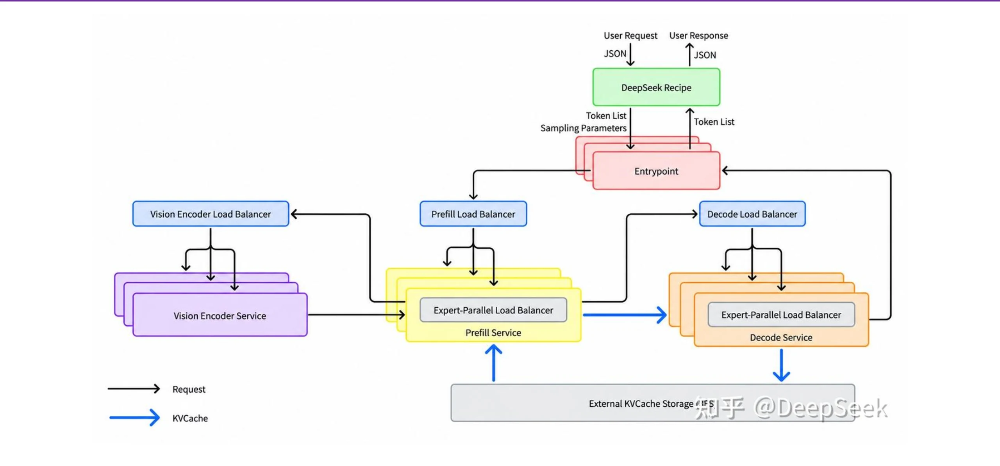
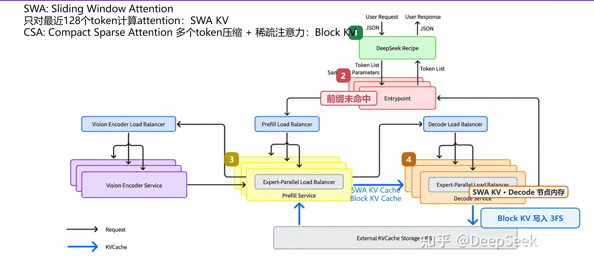
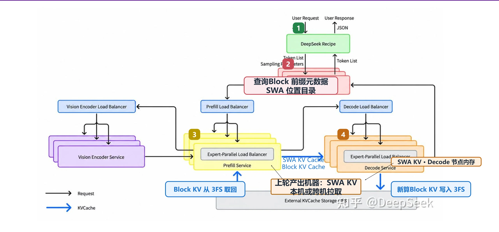
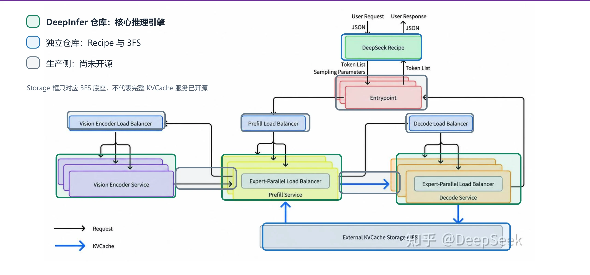
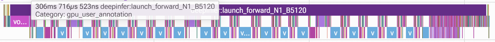
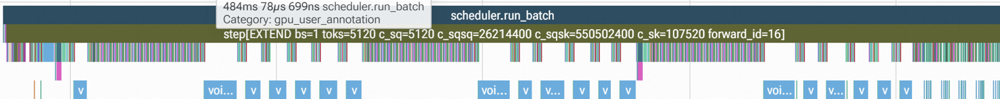
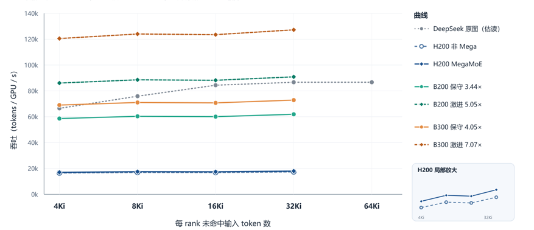

> 针对Deepseek开源的DeepInfer框架做一个简单的总结，包括：整体架构、主要优化。同时基于H200单机部署性能对公布的DSv4.1Flash的Prefill性能进行评估。官方介绍可转到deepseek的github/知乎。

## 生产推理系统的组成

请求先由 **DeepSeek Recipe** 完成 API 协议、prompt 和 token 序列之间的转换，再进入 **Entrypoint**。随后，负载均衡组件将任务送往相应服务池：Vision Encoder 处理图片，Prefill 处理输入并产生生成所需状态，Decode 逐步生成 token。生成结果经 Recipe 解析为正文、思考内容或工具调用等流式事件。

Vision Encoder、Prefill 和 Decode 独立部署，各自有独立的负载均衡。Prefill 和 Decode 的内还有 **Expert-Parallel Load Balancer（EPLB）**。底部的 KVCache Storage 利用 3FS 保存可长期复用的 Block KVCache。

## 单个请求的执行路径

### 第一次请求：没有前缀命中

1. Recipe 转换请求并编码 token；Entrypoint 查询后发现没有可复用前缀。
2. Prefill Load Balancer 分配任务，Prefill 计算全部输入 token，并将后续生成所需状态交给 Decode。
3. Decode Load Balancer 选择实例；Decode 逐步生成 token，Recipe 将结果转换为流式响应。
4. Decode 产生的 **Block KV** 写入独立的 **3FS** 存储池；**SWA KV** 留在产出它的 Decode 机器的主机内存中。

> 这里以纯文本输入为例。这里关于SWA的管理逻辑为猜测；当前官方只给出SWA KV在内存中保存，并不确定这里是Prefill/Decode内存中存储。这里假设最新的SWA KV就存在对应的Decode节点上。

### 第二次请求：前缀命中

Entrypoint 先根据Block KV进行前缀匹配，确定可复用长度，同时查询 **SWA KV所在机器**。这里假设SWA在 Decode 机器上，进行跨机拉取。Block KV 的实际内容从 3FS 异步取回，换入显存的过程尽量与计算重叠。Prefill 只计算未命中的后缀，然后交给 Decode 继续生成。若 SWA 状态已被驱逐，系统通过 **bounded replay** 重算有限的最近 token。

## 当前开源范围

| 组件与能力 | 当前状态 |
|---|---|
| Vision Encoder、Prefill、Decode 的核心模型执行引擎，以及服务内部的 EPLB | 已开源,Deepinfer仓库 |
| DeepSeek Recipe、3FS 文件系统 | 独立仓库 |
| Entrypoint、三类服务池的外层负载均衡、分离部署编排、KV传输\前缀索引、缓存管理 | 无开源实现 |

> Deepinfer对于大规模数据中心来说，并不是一个开箱即用的完整生产系统。

## 核心优化

### 负载均衡

**生产侧的 Prefill 调度**先按输入总长度分为 **<16K、16–64K、64–256K、≥256K** 四档。档内实例按照剩余 compute quota（`cost(q,c)` 一个请求的compute quota是请求总长度 `q` 和cache token长度 `c` 的函数。具体计算逻辑未公开） 从load balancer拉取请求；单个Prefill实例内优先将请求分给 quota 负载较低的 DP rank。单卡组 batch 根据 FIFO 出队，并按照预算切 chunk。博客描述了基于 `cost(q,c)` 的单DP Rank内调度方法，但公开代码中没看到。只看到 FIFO 与 batch token 预算。

**Decode 侧负载均衡**同时考虑batch内req数量和当前一个batch内请求总长度。调度逻辑比较简单，batch一般越大越好。但是一个长req会让一个batch attention计算的时候增加很多读取，而短req则不会。因此这里会优先把长请求给当前batch中token比较少的DP Rank；

**Vision Encoder** 图片像素数量和计算量正相关。根据不同实例正在处理的图片数量可以估计负载，然后进行路由。

**EPLB** 在单个Prefill / Decode 实例内工作：根据历史 token 负载，为热点逻辑专家增加物理副本；逐层把副本放到不同 rank，并将 token 分流到副本（直接做散列计算，可能是本机有专家，但是还是要路由到其它rank上。目的是为了保证计算量均衡）。官方生产配置是 Prefill 使用100步统计窗口，每隔1000步重排，最慢rank / 均值 为1.0618；Decode 使用 统计窗 1000 步，每 10000 步重排一次，线上数据实测 moe_lb = 1.090。

### KV Cache管理

| 类型 | 特点 | 存储与复用 |
|---|---|---|
| Block KV | 体积大，存在长尾命中 | 下沉到 3FS，支持较长期复用；线上 TTL agent流量 约 3 天、chatbot流量 可达 7 天 |
| SWA KV | 体积较小，复用间隔短 | 保存在产生状态的推理机器内存中，由 Entrypoint 定位；TTL 约 180 秒，命中率在 98% 以上 |

读取 Block KV 时，系统尽量逐层加载，让计算与加载互相覆盖。数据换入显存时使用 **GDR(GPU Direct RDMA)** 搬运路径，减少小分片经 GPU 和内存之间的 Copy Engine 低效搬运。SWA 丢失时，bounded replay 只重算最近有限的 token，以少量精度损失换取更低计算量。整套缓存策略与 DeepSeek V4.1 Flash 的模型结构紧密耦合。

### 异步调度与 Recipe

**异步调度**让 GPU 执行第 N 批 forward 时，CPU 同时准备第 N+1 批的调度和启动，并处理更早批次的输出，减少 GPU 等待 CPU 的时间。

**Recipe 输入侧**按已知的特殊标记边界（比如请求中，标记了若干轮对话。每一个对话可以单独tokenize）拆分文本，并行编码普通文本片段后按原顺序拼接，以缩短长上下文的 tokenize 时间。**输出侧**跨 chunk 保存 UTF-8、分隔符匹配和解析阶段状态；（构建了一个状态机，实现流式返回；避免出现非UTF-8编码 / 工具调用不完整的问题）

## 性能评估

比较了Deepinfer和SGLang在单纯GPU Forward上是否有显著差异。（预估基本没有。可以看到上面提到的优化技巧其实都不是在GPU Forward阶段）

### DeepInfer 与 SGLang

使用 DP=EP=8、FP8 DeepGEMM、MegaMoE、Flash MLA，并开启 YOCO Compact。

请求配置为每个 DP rank **100K cache + 5K uncache**。SGLang 的 Indexer 使用 PyTorch 基础实现，DeepInfer 使用社区实现的 SM90 Indexer。使用FP8进行计算。

*DeepInfer Trace*

*SGLang Trace*

| 指标 | DeepInfer | SGLang | 差距 |
|---|---:|---:|---:|
| 整体耗时 | 306 ms | 484 ms | 约 178 ms |
| Indexer 总耗时 | 约 12.5 ms | 约 133 ms | 约 120 ms |
| MegaMoE 40 层总耗时 | 约 132 ms | 约 186 ms | 约 54 ms |

从截图中可以看到，Indexer在SGLang中被展开为大量小算子，导致最终性能效果较差。MOE阶段的耗时差距其实来自SGLang推理期间不同DP Rank的Indexer阶段执行速度不同。

> **结论：如果SGLang等开源引擎接入Deepseek专门实现的算子，在GPU Forward阶段不会有明显性能差异。**

### 与 DeepSeek 公布的 Prefill 吞吐对比

图中灰色虚线是 DeepSeek 公布的离线 Prefill 曲线；H200 两条曲线根据本地 forward 耗时计算，分别对应使用和未使用 MegaMoE（H上的MegaMOE非官方实现。官方实现，MOE阶段有50-70%的提升。这里迁移之后性能一般，MOE阶段仅20%性能提升。E2E仅有3%性能提升）。

B200/B300 的四条曲线均为**估算**：激进估算按 $B series GPU FP4 Dense Flops / H200 FP8 Flops$ 放缩，B200 为 **5.05×**、B300 为 **7.07×**；保守估算逻辑为：根据前面测量的100K + 5K的trace，计算 GEMM/MOE在总时间 $T$ 的占比 $\mu$；然后认为在B卡上的加速比分别为 GEMM/MOE部分加速比为 $B series GPU FP4 Dense Flops / H200 FP8 Flops$。其余部分加速比估算为 $B series GPU HBM BW / H200 series GPU HBM BW$。得到B200、B300加速比分别为 **3.44×**、**4.05×**。

图中H200 由于 64Ki uncache 会 OOM，因此 H200 与 B 系列外推没有该点。

保守估计的 B300 曲线已接近 DeepSeek 公布的数据。因此认为本地 H200 测试基本达到了 DeepInfer 的能力，同时公开的离线测试结果是可信的。

## 总结

DeepSeek 的高效推理来自**模型结构、算子、存储、推理引擎和服务调度**共同作用（Deepseek v4.1 Flash的KV Cache单个token为890Bytes，相比之下，GLM53的单个token KV Cache约 50KBytes；同时Prefill阶段，单个token激活参数约8B；GLM5.3为40B；）。当前 DeepInfer 仓库提供核心引擎距离数据中心级的可用仍有差距（主要来自于KV Cache管理和负载均衡）。同时当前仓库在非N卡和昇腾上仍有不少适配工作。

## 资料链接

- [DeepInfer 仓库](https://github.com/deepseek-ai/DeepInfer)
- [DeepInfer 推理部署问答](https://github.com/deepseek-ai/DeepInfer/blob/main/doc/inference_deployment_qa.md)
- [DeepSeek Recipe](https://github.com/deepseek-ai/deepseek-recipe)
- [3FS](https://github.com/deepseek-ai/3FS)
- [DeepSeek V4.1 Flash 大规模推理部署实践](https://zhuanlan.zhihu.com/p/2095560295930508953)
- [测试使用PR](https://github.com/deepseek-ai/DeepInfer/pull/92)