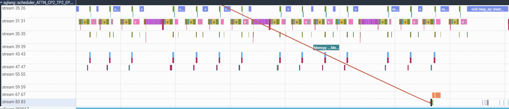
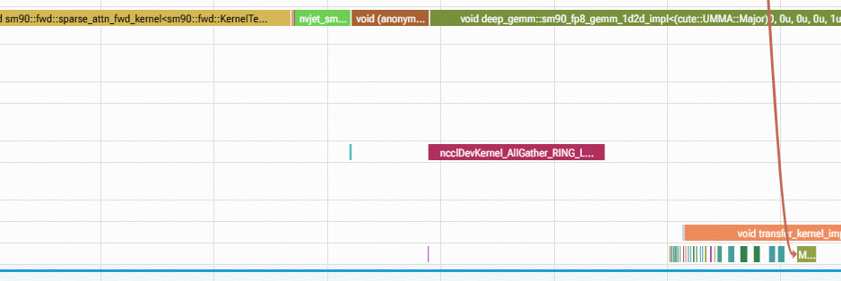
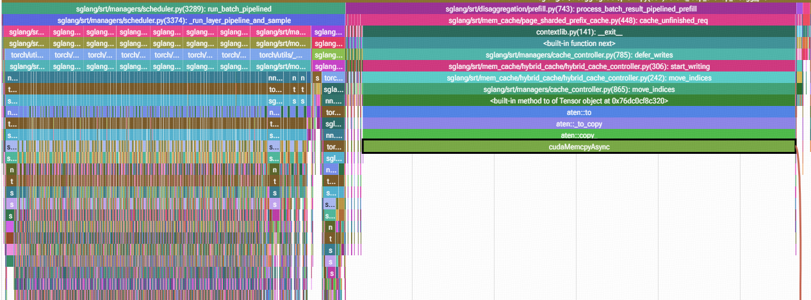
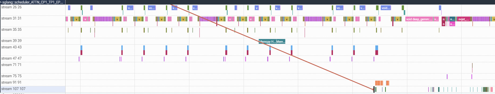
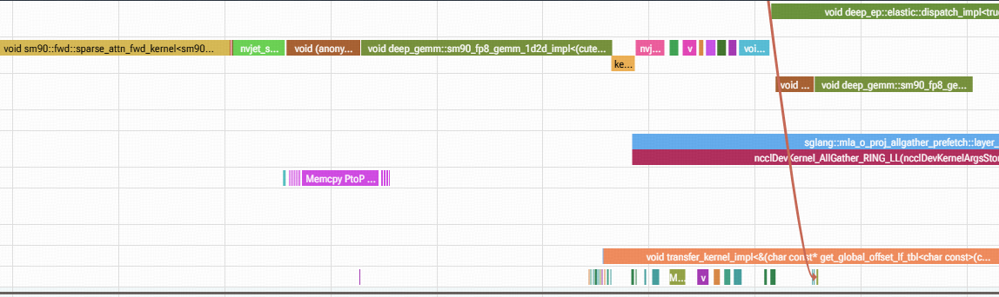
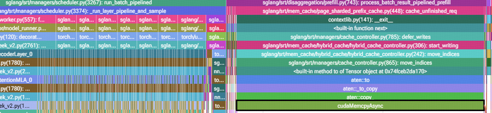
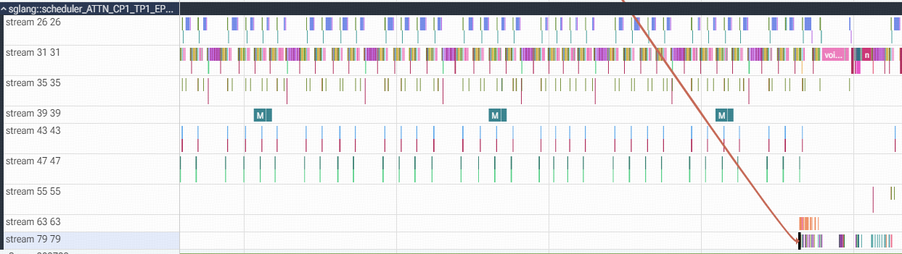
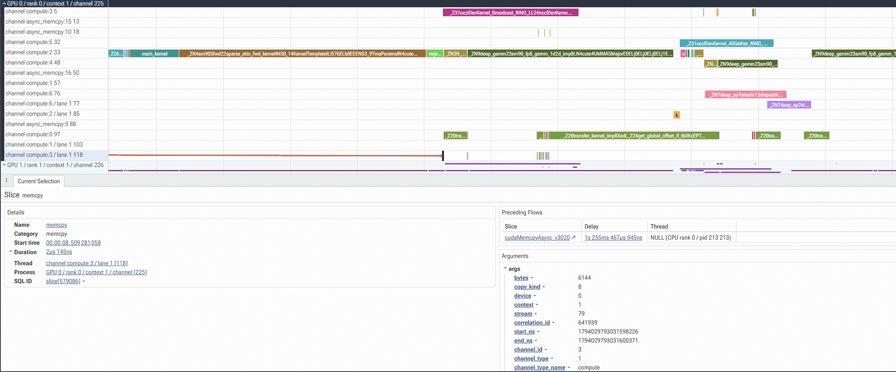

> 一个进程里**会下发 计算kernel 的 CUDA stream 数量超过 `CUDA_DEVICE_MAX_CONNECTIONS`**（默认 8）时，多条 stream 会被驱动映射到同一条硬件工作队列（work queue / channel）。队列内部是严格先进先出的，于是本来互不相关的两条流之间出现了隐式串行依赖。在我们的场景里，请求后处理流上几十微秒的小 kernel 和 memcpy 被排在了 KV AllGather / Broadcast 整个前向的预排 kernel 之后，CPU 侧随之在一次 pageable `cudaMemcpyAsync` 上阻塞约 1.2 s，表现为某个 rank 的 `process_result` 随机变慢、其他 rank 在 collective 上等待。把 `CUDA_DEVICE_MAX_CONNECTIONS` 提到 16 后卡顿消失。

---

## 1. 背景

### 1.1 单 batch 更快，整体回放却更慢

在为 SGLang 开发 Page Shared 的 KV Pool（KV cache 按 page 切分到各 rank、按需 AllGather，替代原有按层切分 + Broadcast 的方案）时，遇到一个反直觉的现象：

| 测量方式 | Page Shared 相对 Baseline |
|---|---|
| 固定输入、单个 batch 的 forward 耗时 | **快 3%～6%** |
| 单独 Prefill 回放（并发 32，真实请求） | **慢 8%～10%**，GPU 利用率也更低 |

每个 batch 的 GPU 工作量确实变少了，但端到端更慢，说明时间花在了 forward 之外。我们给 overlap prefill 的调度循环加了分段 timing（receive / schedule / launch / process_result / inflight 五段，覆盖 8 个 rank），发现长尾集中在两段：

- `process_result`：某个（或几个）rank 比其他 rank 多花约 1 s；
- `inflight`：其余 rank 在下一次 collective 上等那个慢 rank，也多花约 1 s。

哪个 rank 慢、哪个 batch 慢都是随机的，rank0 反而很少出现。

### 1.2 torch profiler：后处理 kernel 被 AllGather 挡住

用 torch profiler 抓到慢 batch 后，CPU 侧的长调用只有一种：`cache_controller.move_indices` 里的 `host_indices.to(cuda, non_blocking=True)`，底层是一次 80 KB 的 pageable Host→Device `cudaMemcpyAsync`。它在 CPU 上耗时 1030～1060 ms，而对应的 GPU 拷贝只有 7～100 µs；同一个 batch 里其他几次同样大小的上传都在 20 µs 内返回。

从 GPU 时间线看，后处理流（负责 transfer plan 构建、索引整理和地址上传的那条 stream）上的 kernel 并没有在等待任何数据依赖，但它们的执行被推迟到了 KV AllGather 流上的 `ncclDevKernel_AllGather_RING_LL` 之后——有时紧跟 AllGather 发出，有时要等 AllGather 完全结束再过一段时间才执行。换成 Copy Engine 版本的 KV AllGather（`Memcpy PtoP`）之后现象一样：后处理 kernel 要等到 PtoP 拷贝执行一半多才被下发。


> 【图 1】Page Shared、connections=8、NCCL AllGather 版本的 torch trace。



**图 1a · 全局视图。** 一个 batch 内各 GPU stream 的时间线。stream 31 是模型前向主计算流，stream 47 是 KV AllGather 流，每层发一次 `ncclDevKernel_AllGather_RING_LL`（图中等间距的红色小块）。stream 83 是后处理流，它的 kernel 全部挤在时间线最右端；红线把其中第一个 kernel 的 CPU 下发点和 GPU 执行点连起来，可以看到下发发生在前向进行到约三分之一时，执行却要等到前向接近结束。



**图 1b · 局部放大。** 把红线落点附近放大。上方是主计算流正在跑的 attention / GEMM，中间是 KV 流的 `ncclDevKernel_AllGather_RING_LL`，底部两行是后处理流：`transfer_kernel_impl` 以及一串几微秒的小 kernel 和 `Memcpy`。它们的 CPU 下发时间与 AllGather 几乎同时，但 GPU 上全部排在最后一个 AllGather 完成之后才开始，中间没有任何 event 等待。



**图 1c · 同一时刻的 CPU 调用栈。** 左半边是上一个 batch 的 `run_batch_pipelined` 正常下发 forward kernel；右半边调用栈为 `process_batch_result_pipelined_prefill → cache_unfinished_req → defer_writes → start_writing → move_indices → aten::to → cudaMemcpyAsync`，最底层的 `cudaMemcpyAsync`（黑框）占满了整段约 1 s 的时间。阻塞下一个step组batch的CPU计算。

> 【图 2】同样配置下 Copy Engine AllGather 版本：后处理 kernel 落在 `Memcpy PtoP` 数据传输与标志位拷贝之间。



**图 2a · 全局视图。** 与图 1a 同一负载，只是 KV AllGather 换成了 Copy Engine 实现：stream 47 上不再是 NCCL kernel，而是每层一组 `Memcpy PtoP`（紫色细条）。后处理流变成 stream 107，它的 kernel 仍然全部被推到时间线右端。说明阻塞与 KV 传输用 SM kernel 还是 Copy Engine 无关。



**图 2b · 局部放大。** 中部粉色是 KV 流的 `Memcpy PtoP`。底部的 `transfer_kernel_impl` 和后处理小 kernel 在 PtoP 之后才开始；（其中后处理小Kernel第一个位于 PtoP 的下方，是被卡住的第一个kernel）。



**图 2c · CPU 调用栈。** 与图 1c 逐帧相同：`process_batch_result_pipelined_prefill` 下面一路到 `move_indices → cudaMemcpyAsync`，黑框里的 `cudaMemcpyAsync` 同样占满整段。两种 KV 传输实现下，CPU 侧的阻塞点是同一行代码。


这两条流在代码里没有任何 event / stream wait 关系，但表现得像有依赖。

### 1.3 CUDA_DEVICE_MAX_CONNECTIONS=16 解决

在不改任何代码路径的情况下，只把 `CUDA_DEVICE_MAX_CONNECTIONS` 从 8 改到 16，受控负载下的长尾完全消失：

| 指标（94 个 batch，任意 rank >500 ms 计长尾） | connections=8 | connections=16 |
|---|---:|---:|
| `process_result` 长尾 batch 数 | 11 | **0** |
| `inflight` 长尾 batch 数 | 11 | **0** |
| `process_result` 最大值 | 1109 ms | 60 ms |
| `inflight` 最大值 | 1073 ms | 28 ms |

真实 30 分钟回放里 Page Shared 也从"持平或更慢"变为相对 Baseline 新算 token 吞吐 +7.3%、P99 −5%。

该环境变量改的是**硬件工作队列的数量**，不是 CUDA stream 的数量；程序创建的 stream 一条没多。下面解释它为什么起作用。

---

## 2. CUDA_DEVICE_MAX_CONNECTIONS 控制什么

### 2.0 stream => 软件队列；channel => 硬件队列

CUDA stream 是运行时层面的有序任务序列。真正送到 GPU 的，是驱动把每个 stream 的命令写进若干条 host→GPU 的**硬件工作队列**（NVIDIA 文档里叫 connection、work queue 或 channel）。GPU 前端从这些队列取命令、解析依赖、再把 kernel 交给 SM 执行。队列的数量由两个环境变量控制（CUDA Programming Guide，Environment Variables）：

| 环境变量 | 取值 | 作用 |
|---|---|---|
| `CUDA_DEVICE_MAX_CONNECTIONS` | 1～32，默认 8 | 控制 host 到每个设备的**并发 compute 和 copy engine 连接（work queue）数量**，两者都被设置为该值 |
| `CUDA_DEVICE_MAX_COPY_CONNECTIONS` | 1～32，默认 8 | 只控制 copy 连接数；仅对 compute capability 8.0 及以上的设备生效 |

默认配置下是 8 条 compute 队列 + 8 条 copy 队列。stream 数超过队列数时，驱动把多条 stream 复用到同一条队列上。

队列内的行为（来自 NVIDIA 的 Streams and Concurrency 讲座及论坛工程师的回答）：

- 同一条队列内严格按下发顺序派发；**一个被阻塞的操作会挡住队列里它后面的所有操作，哪怕那些操作属于别的 stream**。
- event wait 是在 GPU 前端解析的：前端读到一条"等待 event X"的命令后，这条队列就停在那里，直到 event 完成。
- stream 到队列的映射由驱动决定，"类似 round-robin"，没有 API 可以查询或控制。

### 2.1 什么样的 Stream 和 Connection 数量关系会导致卡顿？

#### 2.1.1 测试结果：阈值比 Stream 数量少

统计 trace 里真实执行过 kernel / memcpy / memset 的 stream：

| 方案 | 活跃 stream 总数 | 执行过 kernel 的 stream | 纯拷贝 stream | 观察到卡顿 | 未观察到卡顿 |
|---|---:|---:|---:|---|---|
| Baseline（层切分 + Broadcast） | 9 | **8** | 1 | connections=**7** | connections=8 |
| Page Shared（按 page AllGather） | 10 | **9** | 1 | connections=**8** | connections=9、10、16 |

对 connections 做的扫描：

| 方案 | connections | KV 传输实现 | batch 数 | `process_result` 长尾 batch | `inflight` 长尾 batch |
|---|---:|---|---:|---:|---:|
| Baseline | 7 | NCCL Broadcast | 89 | 87 | 36 |
| Baseline | 8 | NCCL Broadcast | 89 | 0 | 0 |
| Page Shared | 8 | Copy Engine | 94 | 14 | 14 |
| Page Shared | 8 | NCCL AllGather | 92 | 35 | 35 |
| Page Shared | 9 | Copy Engine | 94 | 0 | 0 |
| Page Shared | 9 | NCCL AllGather | 93 | 0 | 0 |
| Page Shared | 10 | Copy Engine | 93 | 0 | 0 |
| Page Shared | 16 | Copy Engine | 94 | 0 | 0 |

注：
- 卡顿与 KV 传输走 NCCL kernel 还是 Copy Engine 无关，两种实现在 connections=8 下都卡、=9 都不卡。
- Baseline 在 connections=7 下几乎**每个 batch 都卡**（87/89），而 Page Shared 在 connections=8 下只有一部分 batch 卡（14/94 或 35/92）。后文 2.3 解释这个差异。

#### 2.1.2 copy流不占用队列

两种方案里都有一条只做 `Memcpy HtoD (Pinned -> Device)` 的 stream：expert offloader 把专家权重从 pinned host 内存预取到显存的流，每次拷贝都是几十 KB 到几百 MB 的大块。按 2.2.2 的观测，这类大块 HtoD 只进 copy engine 队列，不消耗 compute 队列。所以：

- Baseline：8 条发 kernel 的流，需要 ≥8 条 compute 队列，connections=7 时必有两条流共用；
- Page Shared：多了一条发 kernel 的流（KV AllGather 的 pack / copy_pages 流），需要 ≥9 条，默认的 8 不够。

这就是为什么 Page Shared 触发了问题，而 Baseline 在默认配置下恰好安全。

Baseline 在 connections=7 下各流的实际队列分配（用 CUPTI 读出的 channel ID，单个 rank 的 10 秒窗口）：

| 流 | 主要内容 | CUPTI channel 类型 / ID |
|---|---|---|
| 31 | 模型前向主计算流 | compute 2 |
| 35 | 旁路 GEMM（量化 + GEMM + 激活） | compute 4 |
| 26 | DeepEP dispatch / combine | compute 6 |
| 43 | NCCL AllGather | compute 5 |
| **47** | **KV Broadcast（`ncclDevKernel_Broadcast_RING_LL`）+ gather** | **compute 1 / 3** |
| 55 | 少量 GEMM、AllGather | compute 1 / 3 |
| 63 | KV 搬运 `transfer_kernel_impl` | compute 0 |
| **79** | **后处理流：索引整理、cat / index kernel、DtoD、地址上传** | **compute 0 / 1 / 3** |
| 39 | expert 权重 Pinned→Device | async_memcpy 9（不占 compute 队列） |

7 条 compute 队列（ID 0～6）对 8 条发 kernel 的流，必然导致共用；且测试结果显示，正好是 KV Broadcast 流 47 和后处理流 79 分到了同一条 compute 队列。

### 2.2 哪些操作会被阻塞？

#### 2.2.1 疑点：memcpy 为什么也被 AllGather / Broadcast 挡住

按 2.1 的解释，被挡住的应该只有 kernel。但 trace 里，Baseline connections=7 下第一个被卡住的操作是后处理流上的一个 `Memcpy DtoD (Device -> Device)`，Page Shared 下则是 `at::native::unrolled_elementwise_kernel`（一次 PyTorch 的 `copy_`）以及紧随其后的 `Memcpy`。直觉上 memcpy 应当走 copy engine 队列，不该和 Broadcast kernel 排在一起。


> 【图 3】Baseline、connections=7 的 torch trace（rank1，batch 1）：后处理流的 `Memcpy DtoD` 在 `ncclDevKernel_Broadcast_RING_LL` 发出后 100 ms 内下发，但执行被推到整段 Broadcast 之后（距离下发时间约1.2s）。



#### 2.2.2 CUPTI 测试结果：DtoD / 小块 HtoD 被归入 compute channel，Broadcast 同一个 channel ID

torch profiler 和 nsys 都不暴露硬件队列信息。我们用 CUPTI Activity API 写了一个最小采集器（`CUPTI_ACTIVITY_KIND_CONCURRENT_KERNEL` + `MEMCPY`，开启 latency timestamps），直接读每条记录的 `channelID` / `channelType` 以及 kernel 的 `queued` / `submitted` / `start` / `end` 四个时间戳。

CUPTI 对 channel 类型只有两种取值：`CUPTI_CHANNEL_TYPE_COMPUTE`（=1）和 `CUPTI_CHANNEL_TYPE_ASYNC_MEMCPY`（=2）。先看 memcpy 被归到哪类 channel。把 Baseline connections=7 采集到的全部 13,632 次 memcpy 按「拷贝方向 × 字节数 × channel 类型」统计，8 个 rank 结果完全一致：

| 拷贝方向 | 落在哪类 channel | 观察到的字节范围 | 出现的 stream |
|---|---|---|---|
| DtoD | **全部 compute**，与大小无关 | 28 B ～ 283 MB | 31（主计算流）、79（后处理流） |
| DtoH | **全部 async_memcpy**，与大小无关 | 4 B 起 | 31、79 |
| HtoD | ≤ 51,712 B → **compute**；≥ 70,144 B → async_memcpy | 阈值在 50 KB～68.5 KB 之间（推测是 64 KB） | compute 侧在 31、79；async 侧在 39、79 |

注：
- 这个分类规律**只根据当前数据推断**，NVIDIA 没有公开文档描述 memcpy 何时走 compute 队列。
- 分类是按**单次操作**决定的，不是按整条 stream 决定的：主计算流 31 上的 9 次 DtoH 照样被记在 async_memcpy channel，后处理流 79 同时拥有 kernel、compute 类拷贝和 async 类拷贝。expert 权重流 39 全部落在 async 侧，只是因为它的拷贝都是 ≥70 KB 的 HtoD。另外采集器没有记录 `srcKind / dstKind`（pageable / pinned），所以 pinned 与 pageable 是否影响分类，现有数据分不开。

再看共用情况。按「操作类型 × channel 类型 × channel ID × stream」交叉统计（rank1，10 秒窗口）：

| 操作 | copy 类型 | stream | channel 类型 | channel ID | 记录数 |
|---|---|---:|---|---:|---:|
| `ncclDevKernel_Broadcast_RING_LL` | — | 47 | **compute** | **1 / 3** | 378 |
| 后处理小 kernel（`unrolled_elementwise`、cat、index） | — | 79 | **compute** | **1 / 3** | 298 |
| Memcpy | DtoD | 79 | **compute** | **1 / 3** | 92 |
| Memcpy | HtoD（≤ 51 KB） | 79 | **compute** | 1 / 3 | 59 |
| Memcpy | HtoD（80 KB pageable 索引、512 KB） | 79 | async_memcpy | 10 | 29 |
| Memcpy | DtoH | 79 | async_memcpy | 15 | 52 |
| Memcpy | HtoD（Pinned，expert 权重） | 39 | async_memcpy | 9 | 58 |

所以：

1. **DtoD memcpy 和小块 HtoD memcpy 走的是 compute 队列**，和 kernel 排在一起；只有 DtoH 和大块 HtoD 被记在 `ASYNC_MEMCPY` channel 上。
2. 后处理流 79 的 kernel、DtoD memcpy 和 KV Broadcast 流 47 的 kernel **在同一个 compute channel ID 上**（这个 rank 上是 1 或 3），它们在硬件层面就是同一条 FIFO。

> 【图 4】CUPTI 按 channel 分组的 Perfetto 视图（`views/channels.trace.json.gz`）：compute channel 3 既包含 Broadcast kernel 和也有后处理流的 kernel / DtoD 。



#### 2.2.3 完整的阻塞链

一次卡顿的完整过程如下（rank1 某个 batch，以阻塞的 `cudaMemcpyAsync` 调用开始时刻为 0）：

| 时刻 | 事件 |
|---|---|
| −588 ms ～ −3 ms | KV Broadcast 流 47 的 48～49 个 `ncclDevKernel_Broadcast_RING_LL` 被预排进 compute channel 3，每个 kernel 前面带 event wait，按层逐个放行 |
| −3.2 ms | 后处理流 79 的第一个 kernel（cat）被 CPU 下发，`queued` 时间戳落在 channel 3 **队尾** |
| −3.1 ～ −0.1 ms | 流 79 后续的 `unrolled_elementwise`、DtoD memcpy 依次下发，同样排在 channel 3 队尾 |
| −0.01 ms ～ 0 | 流 79 的三次 80 KB pageable HtoD（`host_indices.to(cuda)`）下发；前两次 `cudaMemcpyAsync` 0.02 ms 返回 |
| 0 ms | 第三次 `cudaMemcpyAsync` 开始，**CPU 线程阻塞在此** |
| 0 ～ +1240 ms | channel 3 上 Broadcast kernel 按前向进度逐个执行完（总执行时间约 80 ms，其余是 event-gated 等待）；流 79 的操作一直排在它们后面 |
| +1240.7 ms | 流 79 的 cat kernel 终于开始执行（它本身只需 4.5 µs） |
| +1240.7 ms | 流 79 后面的 kernel、DtoD、三次 HtoD 在 0.3 ms 内全部执行完 |
| +1240.7 ms | 第三次 `cudaMemcpyAsync` 返回，CPU 恢复 |

几个关键点：

- 流 79 上第一个 kernel 从 `queued` 到 `start` 等了 1.24 s，但它没有任何真实依赖；它等的是同一条 channel 里排在前面的、属于另一条流的 Broadcast 序列。Broadcast 序列是 forward 阶段一次性预排的，每个 kernel 前面的 event wait 让 GPU 前端停在队列里，**把后来者一起锁住**。
- CPU 之所以阻塞，是因为 pageable 内存的 `cudaMemcpyAsync` 需要运行时先把数据拷到内部 staging buffer，当前面已排队的 pageable 拷贝还没执行、staging 资源用完时，调用就会同步等待。

这就解释了 1.2 节的观察：CPU 卡 1 s、GPU 拷贝只有几微秒、而 GPU 在这 1 s 里一直是忙的（在跑别的流的前向）。

### 2.3 为什么是"随机"卡顿？

stream 到 channel 的映射不是静态的。同一个 CUPTI 采集窗口里，流 47 在 channel 1 和 3 之间逐 batch 交替，流 79 则在 0 / 1 / 3 之间切换，流 55 跟随流 47 一起换：

```
stream 47 : ch1 [0.1–2.1 s] → ch3 [2.3–4.2 s] → ch1 [4.4–6.4 s] → ch3 [6.6–8.5 s] → ch1 …
stream 79 : ch3 → ch0 → ch1 → ch0 → ch3 → ch0 → ch1 → ch0 → ch3
stream 63 : ch0 [全程]
```

这与论坛上 NVIDIA 工程师的说法一致：映射"类似 round-robin"，驱动动态决定，没有 API 可查、可控。由此可以解释两个现象：

- **卡不卡是概率事件，代价取决于哪两个流冲突。** 和浅队列共享（偶尔发几个小 kernel 的流），延迟是毫秒级，看不出来；和在前向开始时就预排了整轮 event-gated kernel 的流冲突（KV Broadcast / AllGather、attention AllGather、DeepEP 这一类），延迟就是"剩余前向时长"，也就是 1 s 量级。
- **Baseline connections=7 几乎每个 batch 都卡，Page Shared connections=8 只卡一部分。** 前者 8 条流挤 7 条队列，并且从映射轨迹看后处理流 79 每个 batch 都和流 47 落在同一个 channel；后者 9 条流挤 8 条队列，哪两条共用随 batch 变化，只有和 KV AllGather 流冲突的那些 batch 才表现为长尾。

### 2.4 处理方式

- `CUDA_DEVICE_MAX_CONNECTIONS` 设为 **≥ 会下发 kernel 的 stream 数 + 余量**，我们当前固定为 16（上限 32）。
- 数下发 stream 的Kernel时只数执行过 kernel / DtoD memcpy / 小块 HtoD / memset 的流；只做 DtoH 和大块 HtoD 的流走 copy 队列，不计入。不确定可利用 2.2.2 的方法用 CUPTI 读一次 `channelType` 。
- 新增旁路 stream（预取、异步写回、后处理）时，默认应当把它当作一条会占用 compute 队列的流，需要重新核对上限。

---

## 3. 尚未解决的问题

以下两点在现有数据里还不能解释：

1. **同一条 channel 内只有一条 stream 时，kernel 仍有较长的下发→执行间隔。** 理论上命令已经在驱动的队列里，上一个 kernel 执行完后下一个应当立即被前端取走；但 trace 里同一条流、同一条 channel 上相邻 kernel 之间仍存在远大于启动延迟的空隙。需要确认这是 event wait 的解析开销、前端的 channel 轮询粒度，还是 Kernel 之间的资源依赖阻碍下发（https://forums.developer.nvidia.com/t/thread-block-scheduler-uses-disjoint-sms-for-2-kernels-in-separate-streams/322159?utm_source=chatgpt.com）。
2. **GPU 前端与 CPU 驱动交互的具体逻辑。** work queue 里的命令如何被前端取出、依赖（event / semaphore）在哪一级解析、kernel 何时真正交给 work distributor 分配到 SM，目前没有 NVIDIA 公开文档。（https://forums.developer.nvidia.com/t/how-can-i-measure-kernel-launch-overhead-using-ncu/250619/5?utm_source=chatgpt.com）
